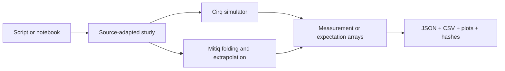

# Quantum experiments

Dave’s personal portfolio of reproducible quantum-computing experiments with **Cirq** and **Mitiq**. Four small studies connect an inspectable circuit to simulator measurements or expectation values, numerical comparisons, tables and plots. Everything runs in one Python environment without an account or hardware service.

| Study | Reader question | Comparison | Notebook |
|---|---|---|---|
| Bell/CHSH game | How often does the entangled strategy win? | Classical 0.75 vs quantum cos(pi/8)^2 | [01](notebooks/01_bell_chsh.ipynb) |
| Amplitude damping | What happens to a qubit prepared with X? | Measured histograms vs density-matrix channel | [02](notebooks/02_damping_sweep.ipynb) |
| Max-Cut QAOA | What cut does a six-node p=2 search find? | Best sampled cut and mean objective vs exhaustive optimum | [03](notebooks/03_qaoa_maxcut.ipynb) |
| ZNE landscape | How does Richardson extrapolation change noise error? | Ideal/raw/mitigated ZZ and absolute errors | [04](notebooks/04_zne_landscape.ipynb) |

## Run a study

Use Python 3.12. In a fresh environment:

```bash
python -m venv .venv
source .venv/bin/activate
python -m pip install .
quantum-experiments bell --out results/bell
quantum-experiments damping --out results/damping
quantum-experiments qaoa --out results/qaoa
quantum-experiments zne --out results/zne
```

Each command writes `report.json`, `data.csv`, `plot.svg`, `plot.png` and `output-hashes.json`. Circuit diagrams accompany the discrete-circuit studies; ZNE stores each folded circuit and its cost in the report. Open a notebook to run its imported study and display the corresponding plot. Notebook support uses `nbclient`, `nbformat` and `ipykernel` from [requirements.in](requirements.in).

For exact reproducibility, use the **resolved hash lock** produced by the [simulation proof workflow](.github/workflows/ci.yml), not a fresh unconstrained resolution. [Reproducibility](docs/reproducibility.md) documents the wheel bootstrap and artifact layout. Generated results are produced by execution rather than stored illustrative upstream output; this source checkout does not include a completed run.

## How the code fits together



The numerical mechanisms come from pinned external examples; thin adapters add explicit seeds, parameter records and portable reports. [Methods](docs/methods.md) explains exactly what each experiment measures. [Sources](docs/sources.md) links the donor files and modifications. All reports label their mode as `simulation`.

## Contribute

Keep changes small and numerical claims inspectable. Follow [CONTRIBUTING](CONTRIBUTING.md), retain upstream attribution and report optimizer termination and mitigation failures alongside improvements.

## License

GPL-3.0-only for the combined adapted work, with Apache-2.0 notices retained for Cirq-derived portions. See [LICENSE](LICENSE) and [third-party notices](THIRD_PARTY_NOTICES.md).
